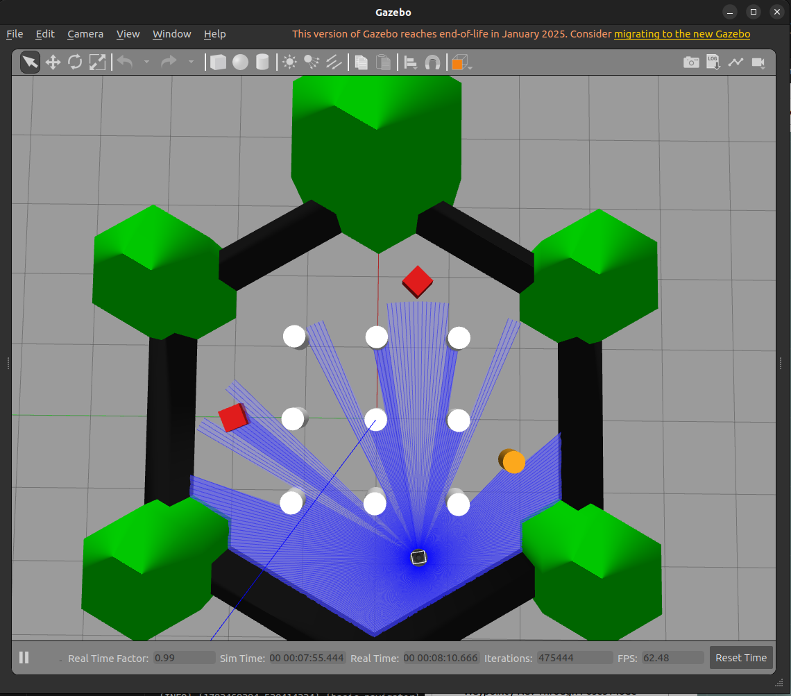
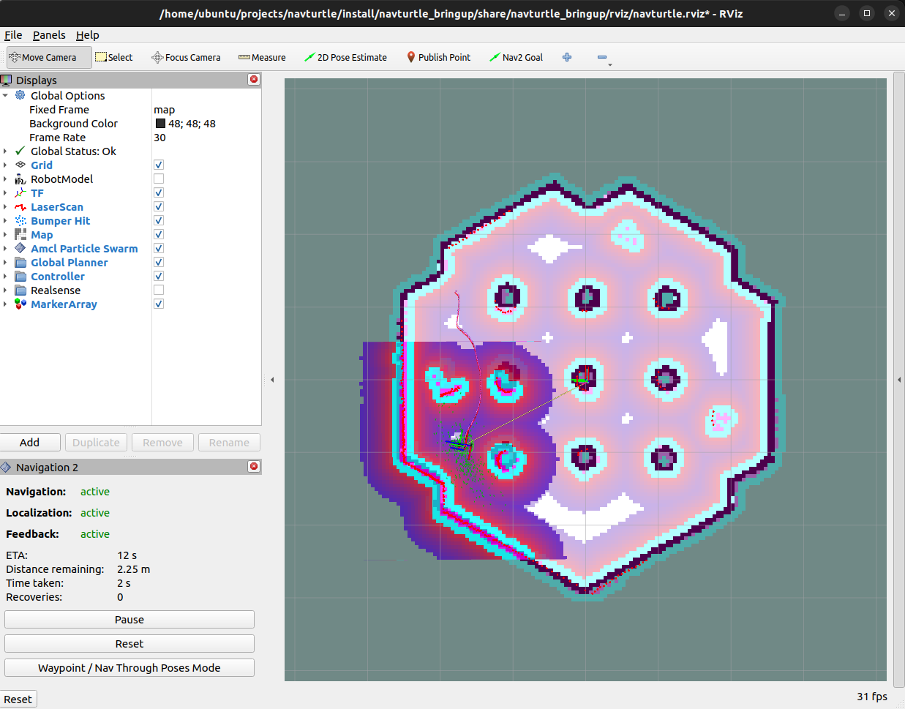

# turtlebot

TurtleBot3 (burger) navigating autonomously in Gazebo with the ROS 2 Navigation2 stack. The robot localizes on a prebuilt map, plans a route through a set of waypoints, and avoids obstacles that are not in the map.

Demo video: [Google Drive](https://drive.google.com/file/d/1pZclG9STVNvwEOh_FhREtxIMToPUn9KJ/view?usp=drive_link)

| Gazebo | RViz |
|---|---|
|  |  |

In Gazebo the red boxes and the orange cylinder are the extra obstacles that are not in the saved map. In RViz the robot has localized, planned a path, and Nav2 reports navigation, localization and feedback as active. The full log of a patrol run is in [docs/patrol_log.md](docs/patrol_log.md).

## Stack

| Component | Version |
|---|---|
| OS | Ubuntu 22.04 |
| ROS 2 | Humble |
| Simulator | Gazebo Classic 11 |
| Navigation | Nav2 (Humble binaries) |
| Robot | TurtleBot3 burger |

## What is in this repo

Nothing here re-implements navigation. The package only wires together existing upstream packages and provides its own world, map, parameters, and a small goal sender.

```
assets/                      screenshots used in this README
docs/                        run logs
scripts/                     helper scripts (install, env, build, run)
src/navturtle_bringup/
  launch/sim_nav.launch.py   Gazebo + robot + Nav2 + RViz in one launch
  worlds/obstacles.world     turtlebot3_world plus three extra obstacles
  maps/                      prebuilt turtlebot3_world map (without the extra obstacles)
  config/nav2_params.yaml    Nav2 params tuned for burger
  rviz/navturtle.rviz        RViz layout
  navturtle_bringup/patrol.py  waypoint route using nav2_simple_commander
```

Reused upstream packages:

- `gazebo_ros` for the Gazebo server and client
- `turtlebot3_gazebo` for the robot model, `robot_state_publisher`, and spawning
- `nav2_bringup` for map server, AMCL, planner, controller, behaviors, BT navigator, and RViz
- `nav2_simple_commander` for sending goals from Python

## Setup

```bash
git clone https://github.com/AnuragGupta181/turtlebot.git
cd turtlebot
./scripts/install_deps.sh   # apt install of Nav2, TurtleBot3, Gazebo Classic
./scripts/build.sh          # colcon build
```

Note: on Ubuntu 22.04, Gazebo Classic conflicts with Gazebo Harmonic (`gz-harmonic`). The install script removes Harmonic if it is present.

## Run

Terminal 1, start the simulation (Gazebo, Nav2, RViz):

```bash
./scripts/run_sim.sh
```

Terminal 2, send the robot around the waypoint route:

```bash
./scripts/patrol.sh          # one lap
./scripts/patrol.sh --loop   # repeat until Ctrl+C
```

You can also send goals by hand with the "Nav2 Goal" button in RViz. The initial pose is already set, so "2D Pose Estimate" is not needed.

## Changes from upstream defaults

`config/nav2_params.yaml` starts from `nav2_bringup/params/nav2_params.yaml` (Humble):

- `robot_radius` 0.22 to 0.105, because the upstream value is for the waffle
- max speed 0.26 to 0.22 m/s, the burger limit
- AMCL `set_initial_pose` with the spawn pose (-2.0, -0.5)

The TurtleBot3 `burger.yaml` for Humble was not used. It still has a `recoveries_server` section from older releases, and Humble ignores it because the node is now `behavior_server`.

## Notes

- `nav2_simple_commander`'s `waitUntilNav2Active()` publishes its stored initial pose (default 0, 0) before it checks `/amcl_pose`. `patrol.py` sets the real spawn pose first, otherwise AMCL gets reset to the wrong place.
- The extra obstacles sit in the open outer ring of the arena. An early version had a box in the middle of four pillars, and the robot got stuck in the narrow gaps.
